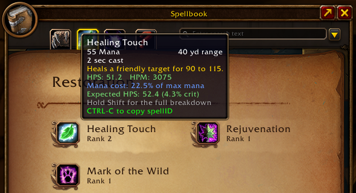
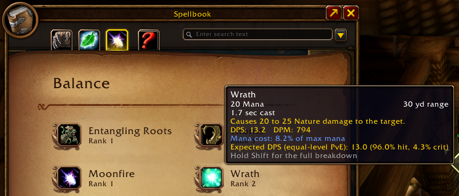

# DamageTips

DamageTips adds DPS, HPS, absorb amounts, and mana costs to action bar and spellbook tooltips in **World of Warcraft: Forever**. It can also show damage or healing per mana, compare spell ranks, and estimate how many casts your current mana can sustain.

**[Download DamageTips 1.6.1 ZIP](https://github.com/SeanShaffer88/DamageTips/releases/download/v1.6.1/DamageTips-1.6.1.zip)** · [Latest release and notes](https://github.com/SeanShaffer88/DamageTips/releases/latest)

## Install

1. Exit WoW. If you're upgrading, back up your existing `DamageTips` folder and its SavedVariables outside `Interface/AddOns`.
2. Extract the ZIP into `_forever_/Interface/AddOns`. The TOC should be at `_forever_/Interface/AddOns/DamageTips/DamageTips.toc`. Keep your SavedVariables to retain your settings.
3. Start WoW, enable DamageTips in the AddOns list, and type `/dtips` to open settings.

## Use DamageTips

- In **Lines**, choose what appears in your tooltips. Hold **Shift** over a spell for its breakdown when Shift details are enabled.
- In **Calculation**, choose whether to include periodic effects. Mixed spells keep their direct damage or healing when you turn periodic effects off.
- In **Advanced**, import or export settings and toggle the minimap button.
- Run `/dtips status` for the detected build, verified spell model count, and estimate settings. Run `/dtips help` for more commands.

## Screenshots

Click either screenshot to view it at full size.

<table>
  <thead>
    <tr>
      <th scope="col">Healing Touch</th>
      <th scope="col">Wrath</th>
    </tr>
  </thead>
  <tbody>
    <tr>
      <td align="center" valign="top">
        
         <strong>Expected HPS: 52.4</strong>
      </td>
      <td align="center" valign="top">
        
         <strong>Expected DPS: 13.0 (equal-level PvE)</strong>
      </td>
    </tr>
  </tbody>
</table>

## Compatibility

DamageTips targets WoW Forever 1.60.1 (Interface 16001). **Spell and attack power scaling** and **Expected DPS and HPS** are off by default and appear only for supported spell ranks on builds **70888** and **70938**. Turn them on in **Lines**.

DamageTips parses spell amounts from English descriptions. On other locales, information supplied by the game, such as mana cost, can still appear when available.

## What's new in 1.6.1

- DamageTips lines return when WoW refreshes a tooltip, without duplicates. Expected damage uses current player stats and eligible target data.
- Spell data refreshes more reliably, next-rank comparisons use the correct spellbook ranks, and Shift details work for healing and absorbs.
- Settings imports are validated before they apply. Imports and resets update the minimap button immediately.
- Build 70938 gains power scaling and expected output for supported spell ranks.

[Full manual](../README.txt) · [Changelog](../CHANGELOG.txt) · [Credits](../CREDITS.txt) · [License (GPL-3.0-or-later)](../LICENSE.txt) · [Report an issue](https://github.com/SeanShaffer88/DamageTips/issues/new?template=bug_report.yml)
